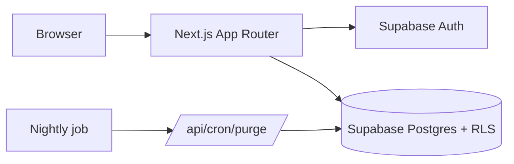
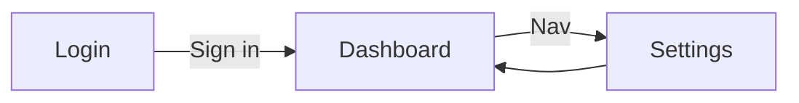
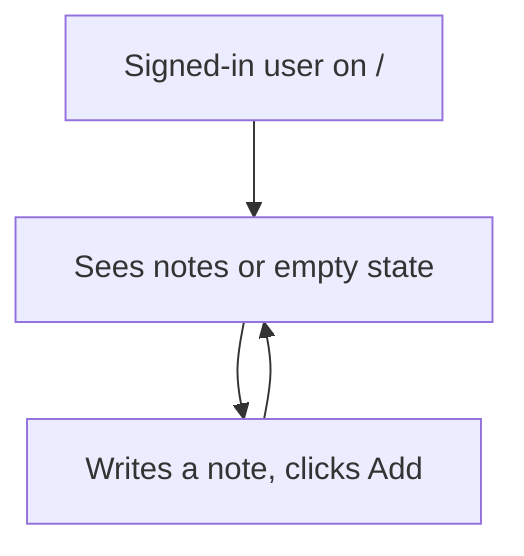
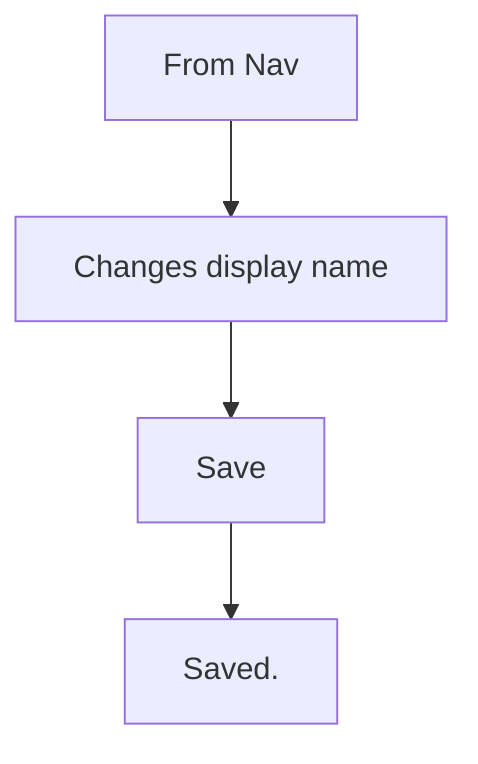
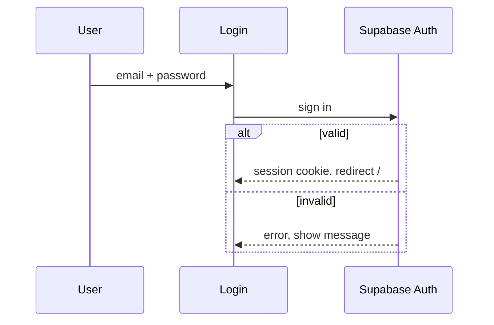
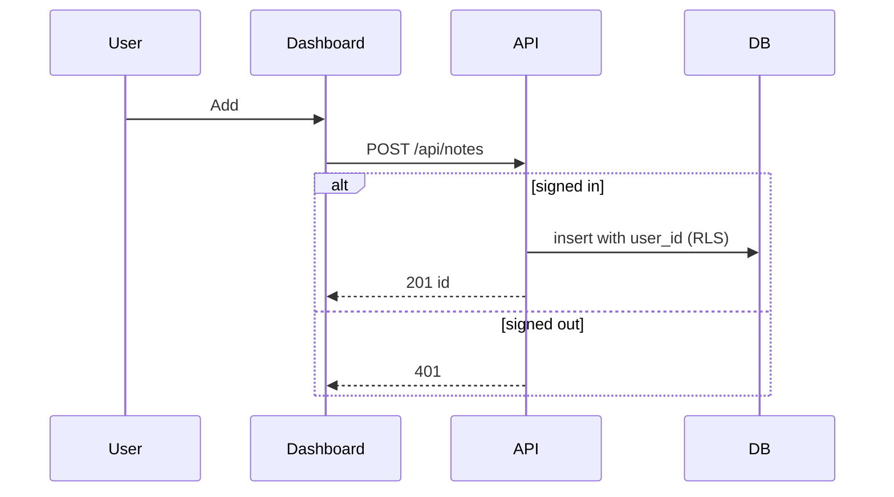
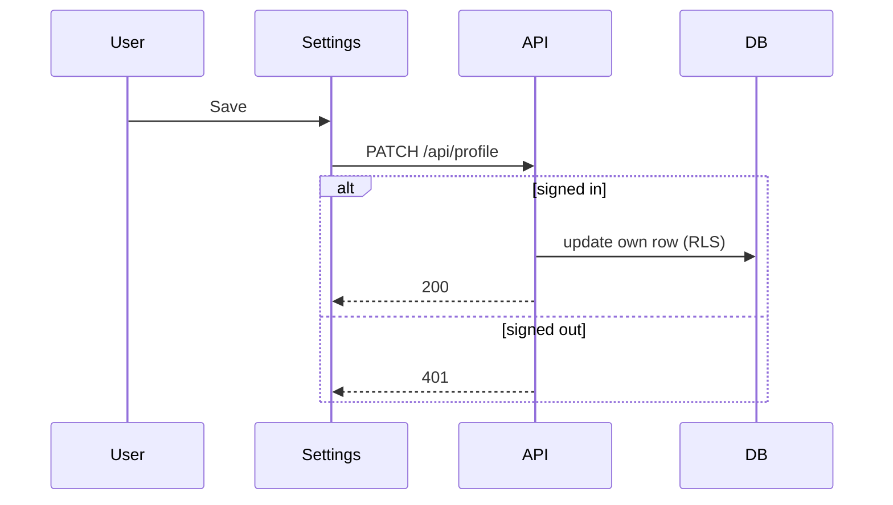
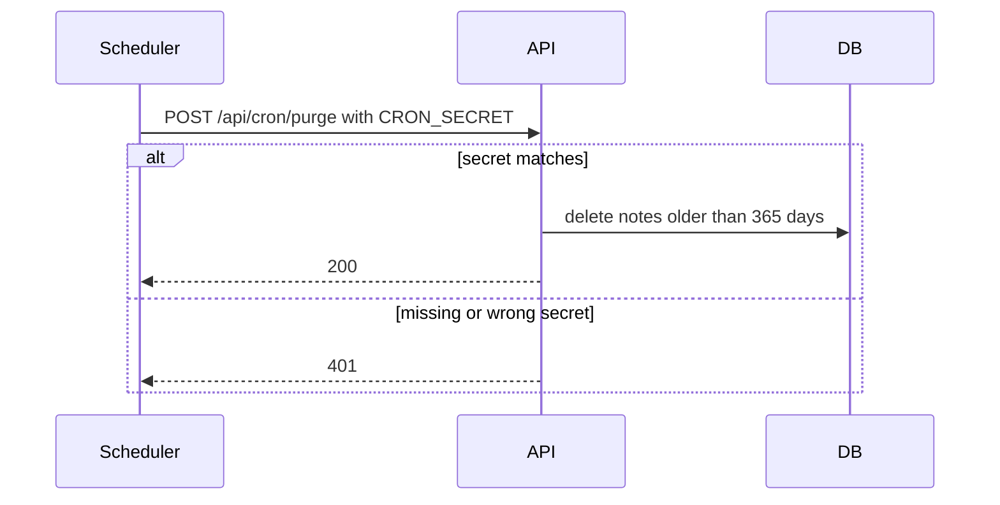

# pf-app-fixture

## Brief
A tiny private notes app, "Jotter App". Audience: a single logged-in user. Goal of v1: sign in, see notes, add a note, change a display name.

## Stack
Next.js (App Router) + Tailwind + shadcn/ui, TypeScript; Supabase for DB and auth.

## Screens

### Login
Route: `/login`
Purpose: email + password sign-in via Supabase auth.
Copy: Headline "Welcome back." Fields: Email, Password. Button "Sign in". Error text "Wrong email or password."
Components: Nav, Input, Button

### Dashboard
Route: `/`
Purpose: list the user's notes and add one.
Copy: Headline "Your notes". Empty state "Nothing yet — write your first note." Textarea placeholder "Write a note…". Button "Add".
Components: Nav, Card, Input, Button

### Settings
Route: `/settings`
Purpose: change display name.
Copy: Headline "Settings". Field: Display name. Button "Save". Success text "Saved."
Components: Nav, Input, Button

## Tokens
```css
:root { --color-bg:#ffffff; --color-fg:#111827; --color-primary:#16a34a; --color-muted:#6b7280; --radius-md:8px; --space-4:16px; --text-base:16px/1.5 Inter,system-ui,sans-serif; --text-4xl:40px/1.1 Inter,system-ui,sans-serif; }
.dark { --color-bg:#0b0f19; --color-fg:#f3f4f6; --color-primary:#4ade80; --color-muted:#9ca3af; }
```

## Components
Nav(links[], user) · Card(title, body) · Input(label, name, type) · Button(label, variant)

## Data model
Table `notes`: `id uuid pk`, `user_id uuid` (references auth.users; user-scoped via RLS), `body text`, `created_at timestamptz default now()`.
Table `profiles`: `user_id uuid pk` (user-scoped via RLS), `display_name text`.
Nightly cron: delete notes older than 365 days.

## Routes / API
GET /api/notes — → 200 [{id, body, created_at}] for the signed-in user; 401 when logged out.
POST /api/notes — {body} → 201 {id}; auth required.
PATCH /api/profile — {display_name} → 200; auth required.

## Diagrams


```mermaid
%% id: page-login
flowchart TD
  Arrive[Signed-out visitor] --> Form[Email + Password] --> Submit[Sign in]
  Submit -->|ok| Dash[/]
  Submit -->|wrong| Err[Wrong email or password.]
```







## Acceptance checks
1. Sign in with the seeded test user succeeds and redirects to `/`.
2. GET /api/notes while logged out returns 401.
3. GET /api/notes while logged in returns 200 and a JSON array.
4. POST /api/notes with `{body:"hello"}` returns 201 and the note appears on `/`.
5. PATCH /api/profile with a new display name returns 200 and `/settings` shows "Saved."
