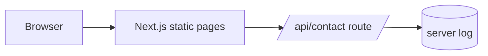
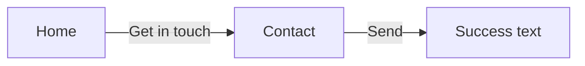
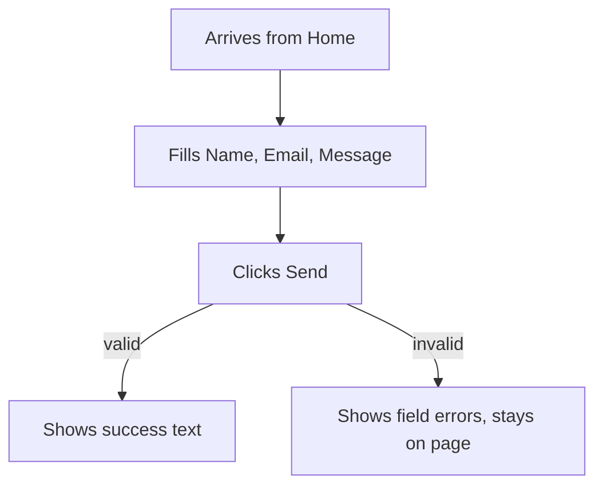
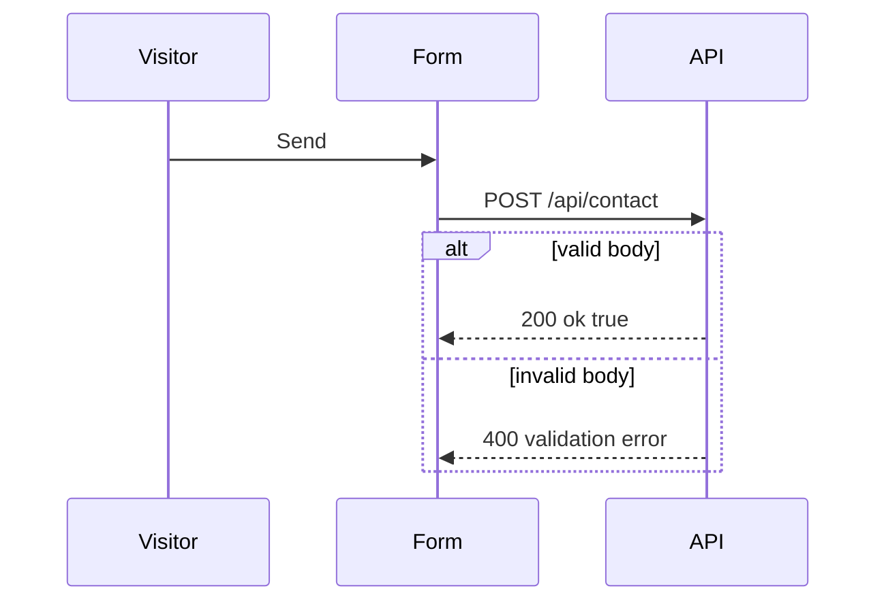

# pf-landing-fixture

## Brief
A two-page landing site for a fictional note-taking app, "Jotter". Audience: indie makers. Goal of v1: explain the product and collect contact messages.

## Stack
Next.js (App Router) + Tailwind + shadcn/ui, TypeScript. No database.

## Screens

### Home
Route: `/`
Purpose: explain Jotter and push visitors to Contact.
Copy: Headline "Notes that stay out of your way." Body "Jotter is a keyboard-first notebook for people who think in lists." Button "Get in touch" → `/contact`.
Components: Nav, Hero, Footer

### Contact
Route: `/contact`
Purpose: collect a message.
Copy: Headline "Say hello." Fields: Name, Email, Message. Button "Send". Success text "Thanks — we'll reply within a day."
Components: Nav, Input, Button, Footer

## Tokens
```css
:root { --color-bg:#ffffff; --color-fg:#111827; --color-primary:#2563eb; --color-muted:#6b7280; --radius-md:8px; --space-4:16px; --text-base:16px/1.5 Inter,system-ui,sans-serif; --text-4xl:40px/1.1 Inter,system-ui,sans-serif; }
.dark { --color-bg:#0b0f19; --color-fg:#f3f4f6; --color-primary:#60a5fa; --color-muted:#9ca3af; }
```

## Components
Nav(links[]) · Hero(headline, body, cta) · Input(label, name, type) · Button(label, variant) · Footer(text)

## Data model
None

## Routes / API
POST /api/contact — {name, email, message} → 200 {ok:true}; no auth; logs to server console.

## Diagrams


```mermaid
%% id: page-home
flowchart TD
  Arrive[Visitor lands on /] --> Read[Reads headline and body] --> CTA[Clicks Get in touch] --> Contact[/contact]
```



## Acceptance checks
1. GET / returns 200 and the HTML contains "Notes that stay out of your way."
2. GET /contact returns 200 and the HTML contains "Say hello."
3. POST /api/contact with a valid body returns 200 and `{"ok":true}`.
4. `npm run build` completes with no errors and Lighthouse accessibility score for `/` is ≥ 90.
